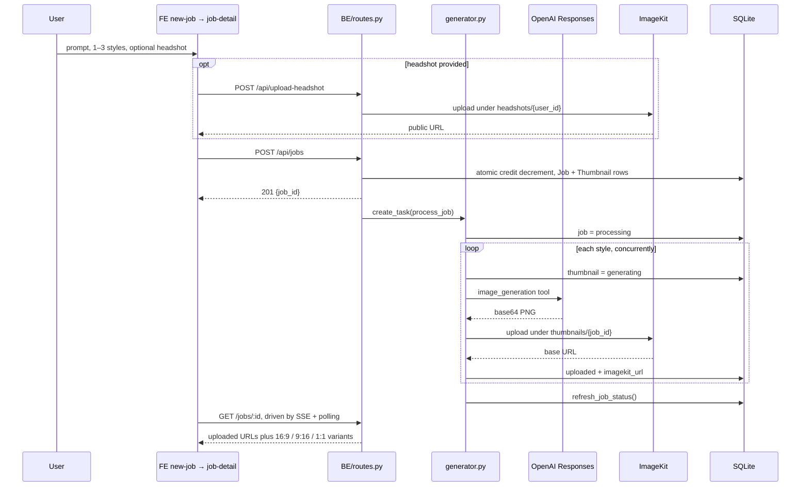
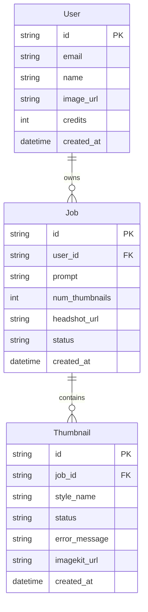
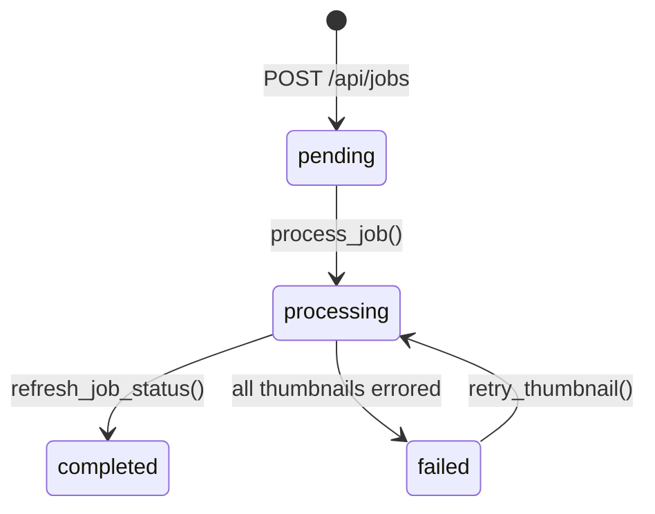
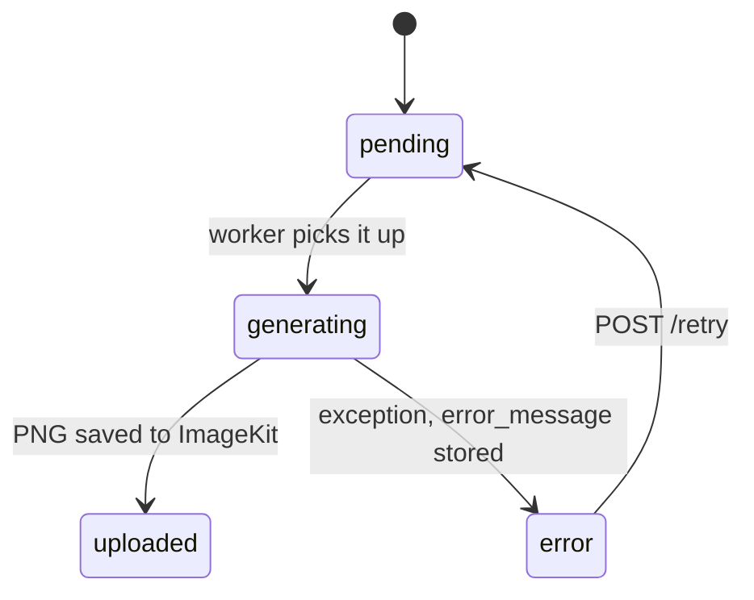
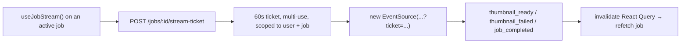

# Thumbnail Builder

A React + FastAPI app that turns one video description into up to three YouTube thumbnails. Add an optional headshot and every style keeps the same face; each result comes back as 16:9, 9:16, and 1:1 crops.

Sign-in is Clerk (Google or email/password). Free accounts start with three generations. One generation spends one credit and produces one to three styles.

## Run it locally

Prerequisites: Python 3.14, pnpm, a Clerk instance, an OpenAI key, and an ImageKit account.

```bash
# Terminal 1 — API on 127.0.0.1:8080
cd BE
python -m venv .venv
source .venv/bin/activate
pip install -r requirements.txt
python main.py

# Terminal 2 — Vite on http://localhost:5173
cd FE
pnpm install
pnpm dev
```

`python main.py` starts Uvicorn with reload on port 8080. That is the target of the `/api` proxy in `FE/vite.config.ts`. Running `uvicorn main:app --reload --port 8080` from `BE/` is equivalent.

Both `.env` files are gitignored. These are the variables the code reads — names and defaults only:

| Where | Variable | Used for | Default |
| --- | --- | --- | --- |
| `BE/.env` | `OPENAI_API_KEY` | Responses API image generation | — |
| `BE/.env` | `CLERK_SECRET_KEY` | session verification and profile lookup | — |
| `BE/.env` | `CLERK_AUTHORIZED_PARTIES` | comma-separated origins Clerk accepts | unset |
| `BE/.env` | `IMAGEKIT_PRIVATE_KEY`, `IMAGEKIT_PUBLIC_KEY`, `IMAGEKIT_URL_ENDPOINT` | uploads and transform URLs | — |
| `BE/.env` | `CORS_ORIGINS` | comma-separated allowed origins | `http://localhost:5173` |
| `BE/.env` | `FREE_CREDITS` | credits granted on first sign-in | `3` |
| `BE/.env` | `DATABASE_URL` | SQLModel connection string | `sqlite:///./thumbnailbuilder.db` |
| `BE/.env` | `SQL_ECHO` | log SQL statements | `0` |
| `FE/.env.local` | `VITE_CLERK_PUBLISHABLE_KEY` | `ClerkProvider` | required; the app shows a config screen without it |
| `FE/.env.local` | `VITE_API_BASE_URL` | absolute API origin for production | `/api` (dev proxy) |

`MAX_STYLES_PER_JOB` (3) and `MAX_HEADSHOT_BYTES` (5 MB) are constants in `BE/config.py`, not environment variables.

The frontend never calls the OpenAI or ImageKit APIs directly — it only loads the URLs those calls produce. `useApi()` mints a fresh Clerk token per request; `BE/auth.py` verifies it and creates the local `User` row on first sight, so there is no webhook or sync job. Credits live in that local row, not in Clerk.

ImageKit does two jobs: it stores the headshot and generated PNGs, and it produces the three crop URLs by appending `tr=w-...,h-...,c-maintain_ratio,fo-auto` to the base URL. Regenerating a crop never calls the model again.

## One generation, end to end



The three style prompts (`bold_dramatic`, `clean_minimal`, `vibrant_energetic`) live in `BE/services/generator.py` beside the UI copy for the style picker, so labels and prompts cannot drift apart.

Two details in `BE/services/openai_service.py` matter more than they look:

- The image tool uses `action: "edit"` when a headshot URL is present and `"generate"` otherwise. `"generate"` tells the model to ignore images in context, which is why a reference photo can be silently ignored. The headshot goes in as an `input_image` and needs to be publicly reachable — opening it in your browser is not proof that OpenAI can fetch it.
- Model IDs are `gpt-6-luna` for the Responses call and `gpt-image-2.6-flare` for the image tool. The tool returns a 1536×1024 PNG before ImageKit derives the crops.

## Data model



`User.id` is the Clerk user ID. `Job.num_thumbnails` is the number of selected styles, not the number of output crops. Both job IDs and thumbnail IDs are UUID4.

## States

Job status is derived from the thumbnails rather than set directly by the workers:



Each thumbnail moves independently:



Retry re-runs one style without spending another credit. `retry_thumbnail()` rejects retries while a thumbnail is `pending` or `generating`.

## Progress and retries



`EventSource` cannot send an `Authorization` header, so the client exchanges its Clerk session for a short-lived ticket and puts that in the query string. Tickets are multi-use within their 60-second TTL so a reconnect does not 401, and are bound to both a user and a job.

The SSE generator reads the database every 1.5 seconds and emits a comment ping roughly every 12 seconds to keep proxies from closing an idle stream. React Query also polls `GET /jobs/:id` every 8 seconds while a job is active, so a failed ticket or dropped stream is only a latency problem, not a dead end.


## API

`/api/health` and `/api/styles` are public. Every other route requires a Clerk session token.

| Method | Path | Purpose |
| --- | --- | --- |
| `GET` | `/api/health` | Liveness check |
| `GET` | `/api/me` | Local profile and remaining credits |
| `GET` | `/api/styles` | Style names, labels, descriptions |
| `POST` | `/api/upload-headshot` | Multipart image upload, max 5 MB |
| `POST` | `/api/jobs` | Start a 10–600 char prompt with 1–3 styles |
| `GET` | `/api/jobs` | Last 50 jobs, newest first |
| `GET` | `/api/jobs/{job_id}` | Job plus thumbnails and variant URLs |
| `POST` | `/api/jobs/{job_id}/stream-ticket` | Mint a 60-second SSE ticket |
| `GET` | `/api/jobs/{job_id}/stream?ticket=` | SSE progress stream |
| `POST` | `/api/jobs/{job_id}/thumbnails/{thumbnail_id}/retry` | Re-run one style |

Jobs are owner-scoped. A job belonging to someone else returns 404 rather than 403 so the API does not confirm that it exists.

## Layout

```
BE/
  config.py              env vars and product limits
  main.py                FastAPI app, CORS, Uvicorn entry point
  auth.py                Clerk verification, lazy user creation
  routes.py              /api endpoints, credit spend, SSE stream
  models.py              SQLModel tables
  database.py            engine and session factory
  services/
    generator.py         style prompts, job worker, retry, status derivation
    openai_service.py    Responses API call and image decoding
    imagekit_service.py  uploads and crop transform URLs
FE/
  src/App.tsx            router, ClerkProvider, auth boundary
  src/lib/api.ts         typed fetch client
  src/lib/download.ts    blob-URL download helper
  src/lib/styles.ts      client-side style fallback
  src/hooks/             API binding, SSE subscription, document title
  src/routes/            landing, auth, dashboard, new job, job detail, billing, settings
  src/components/ui/     shadcn components (base-nova style, Base UI primitives)
```

## Sharp edges

- `openai` is pinned to 1.78.1. On Python 3.14 that SDK tries to cache discriminator metadata by setting `__discriminator__` on `typing.Union`, which is now slotted. `openai_service.py` avoids the broken code path with `with_raw_response` and `json.loads(raw_response.content)`. Replacing that with `client.responses.create(...)` will crash after a successful API call unless the SDK is upgraded.
- There is no Alembic setup. `create_table()` calls `SQLModel.metadata.create_all()` on startup, which creates missing tables but does not alter existing ones.
- Background work is in-process `asyncio.Task`s held in a module-level set. A restart kills running jobs and leaves their rows marked `processing`. More than one worker needs a real queue.
- Stream tickets live in a process-local dictionary. Multiple API workers need sticky routing or shared storage.
- Downloads go through `fetch` → blob → object URL because browsers ignore `download` on cross-origin URLs. Each card also has an expand dialog for the selected crop.
- `SITE.contactEmail` in `FE/src/lib/site.ts` is still a placeholder address. Change it before letting real users see billing or settings.
- The production bundle is about 886 kB and Vite warns about chunk size. Code splitting has not been done.
- There are no automated tests yet. The checks below are static checks only.

## Deployment notes

The intended target is Cloudflare Pages for the frontend and Fly.io for the API. It is not wired up yet. `FE/public/_redirects` already provides the SPA fallback. For a real deployment, set `VITE_API_BASE_URL`, add the API origin to `CORS_ORIGINS`, and point `DATABASE_URL` at a persistent volume.

## Checks

```bash
cd FE && pnpm build && pnpm lint
cd .. && basedpyright
```

`basedpyright` currently reports 0 errors. The frontend build emits the chunk-size warning described above.
